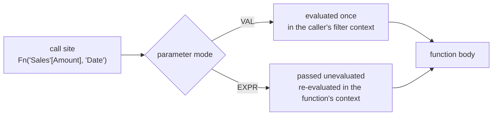

# Authoring DAX user-defined functions

How to write the body and signature of a UDF: the parameter type system, evaluation modes, type checks, and patterns. For when a UDF earns its place, naming and documentation, see [`organize-semantic-model/references/udfs.md`](../../organize-semantic-model/references/udfs.md).



## Signature

```dax
DEFINE
    /// Adds tax to an amount
    FUNCTION Finance.AddTax = ( amount : NUMERIC, rate : DOUBLE ) =>
        amount * ( 1 + rate )
```

In TMDL the same function is a `function` object, written to `definition/functions.tmdl`:

```tmdl
createOrReplace
    function Finance.AddTax = ( amount : NUMERIC, rate : DOUBLE ) => amount * ( 1 + rate )
```

A parameter is `name : [TYPE] [SUBTYPE] [MODE]`. Every part is optional; a bare name is `ANYVAL VAL`.

```yaml
types:
  value types (evaluated before the call):
    ANYVAL: scalar or table, the default
    SCALAR: scalar only
    TABLE:  table only
  expression types (always EXPR mode):
    ANYREF: any reference
    COLUMNREF, TABLEREF, MEASUREREF, CALENDARREF: a reference of that kind
scalar subtypes:
  NUMERIC:  any number (Int64, Decimal, Double)
  INT64:    whole number, rounds the argument
  DECIMAL:  fixed precision (Currency)
  DOUBLE:   floating point
  STRING, DATETIME, BOOLEAN
  VARIANT:  any scalar
modes:
  VAL:  eager, the argument is evaluated once at the call site (default for value types)
  EXPR: lazy, the argument is evaluated inside the function, in whatever context the body sets
shorthand:
  "x : INT64":       SCALAR INT64 VAL
  "t : TABLE EXPR":  lazy table
```

## VAL versus EXPR

The mode decides which filter context an argument sees. With `VAL`, `CALCULATE` inside the body cannot change the argument, because it is already a value. With `EXPR`, the body can wrap the argument in `CALCULATE` or `CALCULATETABLE` and change its context.

```dax
DEFINE
    FUNCTION CountEager = ( t : TABLE VAL ) =>
        COUNTROWS ( t )

    FUNCTION CountAllDates = ( t : TABLE EXPR ) =>
        COUNTROWS ( CALCULATETABLE ( t, ALL ( 'Date' ) ) )
```

Use `VAL` for plain inputs such as amounts, rates and keys. Use `EXPR` when the function must evaluate the argument under a different filter context, for example time intelligence that takes a measure. Measure arguments that are meant to be re-evaluated per period need `EXPR` (or `MEASUREREF`); passed as `VAL`, they arrive as one fixed number.

## Type checks

A parameter without a subtype can take several types; branch on the type at run time.

```yaml
UDF-era checks: ISINT64, ISDOUBLE, ISDECIMAL, ISNUMERIC, ISSTRING, ISDATETIME, ISBOOLEAN
older checks:   ISNUMBER, ISTEXT, ISLOGICAL
```

```dax
DEFINE
    FUNCTION Currency.Name = ( currency ) =>
        IF (
            ISINT64 ( currency ),
            LOOKUPVALUE ( 'Currency'[Currency], 'Currency'[CurrencyKey], currency ),
            LOOKUPVALUE ( 'Currency'[Currency], 'Currency'[Code], currency )
        )
```

Fail loudly on input the function cannot handle, rather than returning BLANK that hides the mistake:

```dax
DEFINE
    FUNCTION Double = ( input ) =>
        IF ( ISNUMERIC ( input ), input * 2, ERROR ( "Double: input must be numeric" ) )
```

## Calling a UDF

A UDF is called like any DAX function, from measures, calculated columns, calculation items, visual calculations and other UDFs.

```dax
Total With Tax = Finance.AddTax ( [Total Sales], 0.21 )
```

In a calculated column, wrap the result in `CONVERT` when the column must keep one data type, since the return type is not declared:

```dax
Sales Tax = CONVERT ( Finance.AddTax ( 'Sales'[Amount], 0.21 ), CURRENCY )
```

Functions can call other functions defined before or after them in the same model. Recursion and mutual recursion are not allowed.

## Pattern: flexible key with a lookup

```dax
DEFINE
    FUNCTION Currency.Convert = ( amount : DECIMAL, target, useAverage : BOOLEAN ) =>
        VAR _Key =
            IF (
                ISINT64 ( target ),
                target,
                LOOKUPVALUE ( 'Currency'[CurrencyKey], 'Currency'[Code], target )
            )
        VAR _Rate =
            IF (
                useAverage,
                LOOKUPVALUE ( 'Rates'[AvgRate], 'Rates'[CurrencyKey], _Key ),
                LOOKUPVALUE ( 'Rates'[EndRate], 'Rates'[CurrencyKey], _Key )
            )
        RETURN
            amount * _Rate
```

## Testing

Define the function in the query and evaluate it against fixed inputs before saving it to the model. Run the query with `te query` (see the [`te-cli` skill](../../../../tabular-editor/skills/te-cli/)):

```dax
DEFINE
    FUNCTION Finance.AddTax = ( amount : NUMERIC, rate : DOUBLE ) => amount * ( 1 + rate )
EVALUATE
{ Finance.AddTax ( 100, 0.21 ), Finance.AddTax ( 0, 0.21 ), Finance.AddTax ( BLANK (), 0.21 ) }
```

Include an edge case per parameter: BLANK, zero, a wrong type. For `EXPR` parameters, evaluate inside `SUMMARIZECOLUMNS` over the dimension the function changes, so the context transition is visible in the result.

## Restrictions to design around

```yaml
no optional parameters or default values: every argument is required
no overloading:    one function per name; branch on type instead
no recursion:      direct or mutual
no return type:    the result type follows the body; CONVERT where it matters
renames:           references to a renamed function or parameter are not updated
```

Check the current Microsoft Learn page for UDFs before relying on a restriction: the feature shipped in preview in September 2025 and some of these may have been lifted.
