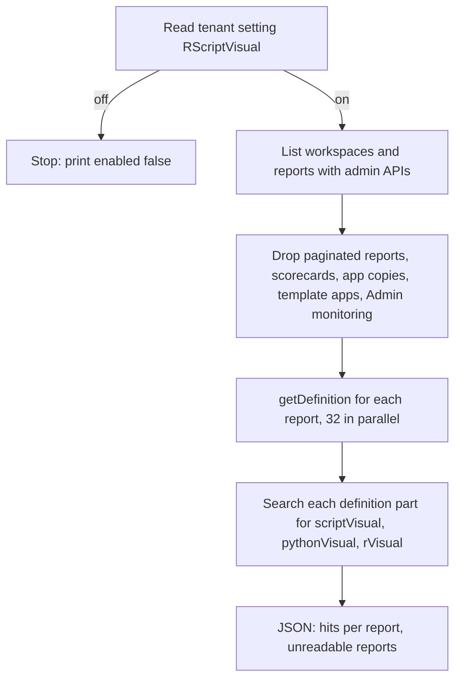

# Find R and Python visuals

Finds every report in a tenant that uses R or Python visuals.

Microsoft is retiring R and Python visuals in Power BI ([announcement](https://community.fabric.microsoft.com/blog/fbc_pbiupdatesblog/announcing-the-retirement-of-r-and-python-visuals-in-power-bi/5400748)). Before you rebuild anything, you need the list of reports that still use them.



## Requirements

- Python 3.12 or later and [uv](https://docs.astral.sh/uv/)
- Azure CLI, signed in with `az login` as a Fabric administrator
- Write access to the reports. The Fabric `getDefinition` API needs it; admin rights alone are not enough

## Usage

```bash
uv run --script find-script-visuals.py > results.json
uv run --script find-script-visuals.py 64 > results.json
```

The optional argument sets the number of parallel requests. The default is 32.

When the tenant setting "Interact with and share R and Python visuals" (`RScriptVisual`) is off, the script prints `{"setting": "RScriptVisual", "enabled": false}` and stops.

## Output

```json
{
  "setting": "RScriptVisual",
  "enabled": true,
  "reports": 424,
  "scanned": 423,
  "unreadable": [{"workspace": "sales-dev", "reportId": "...", "name": "Sales Report", "status": "unreadable"}],
  "withScriptVisuals": [{"workspace": "finance", "reportId": "...", "name": "Forecast", "status": "scanned", "hits": {"pythonVisual": 2, "scriptVisual": 1}}]
}
```

- `scriptVisual` is an R visual. `pythonVisual` is a Python visual
- Each count is the number of visuals of that type in the report
- A report is unreadable when you have no access to its workspace, or when it has no semantic model

On a tenant with 424 reports, a full run took 1m48s.

## How it works

- The script gets tokens from `az account get-access-token`
- It lists reports with the Power BI admin API (`admin/reports`), because that API shows the report type and whether a report is a scorecard or an app copy
- It reads each definition with the Fabric API (`reports/{id}/getDefinition`). This API returns `Retry-After: 20`, but the definition is ready after about 1 second, so the script checks every 0.5 seconds instead
- It retries on HTTP 429 and 5xx errors

## Alternatives

- **No Fabric admin rights:** change the report list to `GET https://api.fabric.microsoft.com/v1/workspaces/{id}/items?type=Report` for each workspace you can access. Skip the tenant setting check, or ask an admin for its value
- **Fabric CLI:** `fab export "<workspace>.Workspace/<report>.Report" -o ./out` writes a definition to disk. Then search it with `rg -l '"visualType":\s*"(scriptVisual|pythonVisual)"' ./out`. This is slower, because it runs one process for each report
- **PowerShell:** with the `MicrosoftPowerBIMgmt` module, `Export-PowerBIReport` downloads each report as a `.pbix`. Search the `Report/Layout` file in the archive for the same visual types
- **Fabric notebook:** semantic-link-labs `ReportWrapper` lists the visuals in a report, with their type. Use it when you want to run the scan in a notebook. A notebook uses capacity units
- **Scanner API (`admin/workspaces/getInfo`):** it does not return visuals, so it cannot find R and Python visuals

## Considerations

- App copies (`[App] ...`) and template apps are excluded. They copy a source report, so the scan finds the visuals in the source
- The scan only reads; it changes nothing in the tenant
