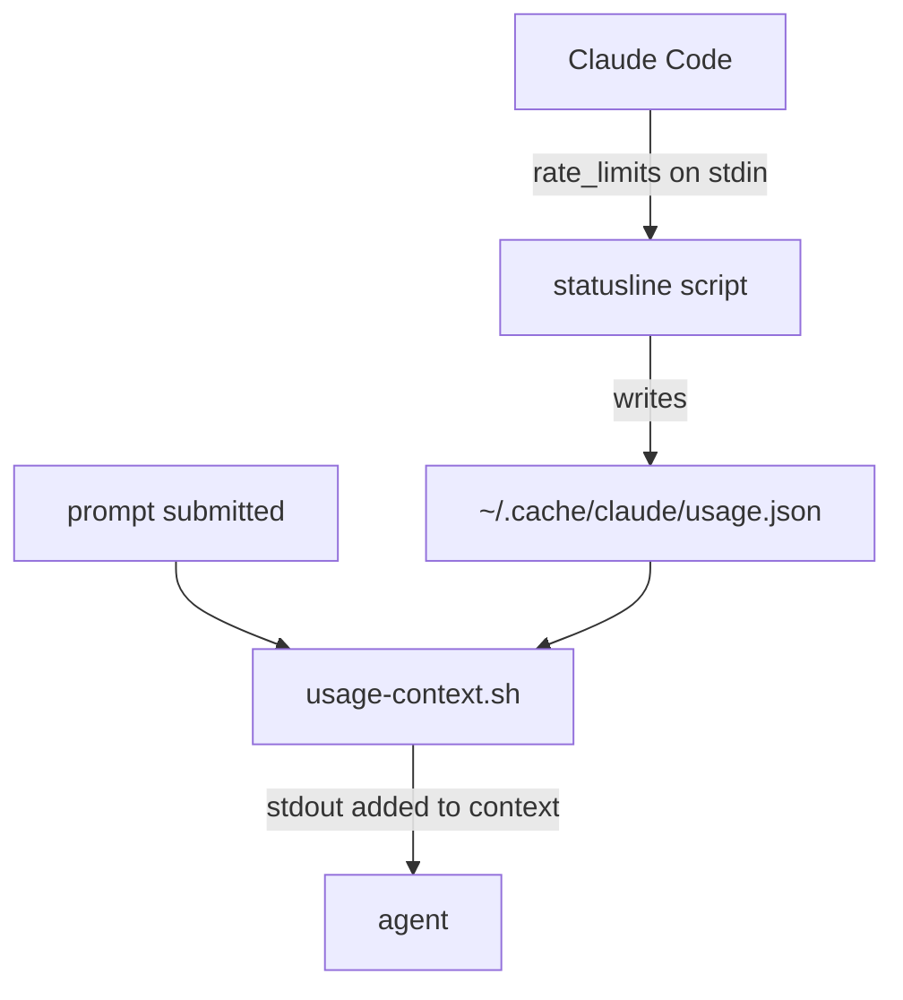

# Usage context

A UserPromptSubmit hook that tells the agent how much of the Claude plan's 5-hour and weekly limits is used, so it can plan around them.



## Why

Claude Code passes `rate_limits` to the statusline command but not to hooks. The statusline writes them to a file; this hook reads that file on every prompt. The agent then sees a line like:

```
Claude plan usage (0 min old): 5h 12%, resets Fri 15:50Z; week 6%, resets Thu 01:00Z
```

## Installation

1. Add one line to your statusline script, after it reads stdin into `$input`. The statusline in [`status-lines/`](../../status-lines/) already has it:

   ```bash
   jq -e '.rate_limits' <<<"$input" >/dev/null 2>&1 && mkdir -p "$HOME/.cache/claude" && jq -c '.rate_limits' <<<"$input" > "$HOME/.cache/claude/usage.json"
   ```

2. Copy `usage-context.sh` to `~/.claude/hooks/` and make it executable.
3. Add the hook entry from `settings.json.example` to `~/.claude/settings.json` under `hooks.UserPromptSubmit`.

## How often it runs

The statusline writes the file each time Claude Code redraws it: on every prompt and every tool call, debounced by 300 ms. The hook reads it on every prompt. If your statusline sets `refreshInterval`, it also writes on that timer; leave it unset to keep writes to prompts and tool calls.

To write at most once a minute instead, guard the statusline line with the file's age:

```bash
f="$HOME/.cache/claude/usage.json"
[ -z "$(find "$f" -mmin -1 2>/dev/null)" ] && jq -e '.rate_limits' <<<"$input" >/dev/null 2>&1 && mkdir -p "${f%/*}" && jq -c '.rate_limits' <<<"$input" > "$f"
```

## Limits

- Needs `jq` and a Pro or Max plan; `rate_limits` is absent on API billing
- Values are only as fresh as the last statusline render, and appear after the first reply in a session
- Adds about 25 tokens to every prompt
