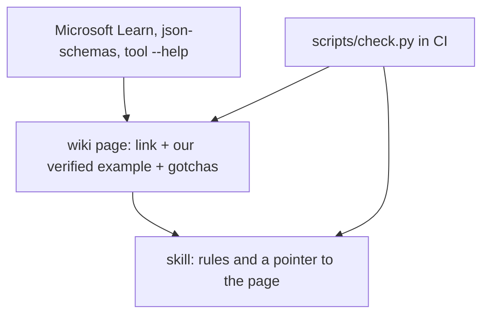

# Wiki

Reference notes for Power BI and Fabric work that Microsoft Learn does not cover, or covers without the detail an agent needs: verified examples, gotchas, version-specific behaviour and the commands that prove each claim. Every page links the Learn article it builds on.

- Pages live inside the plugin that uses them, at `plugins/<plugin>/wiki/<topic>.md`, so they install with the plugin and a skill can read them offline
- [index.md](index.md) lists every page; it is generated, do not edit it by hand
- [SCHEMA.md](SCHEMA.md) is the page contract: frontmatter, sources, verification
- [log.md](log.md) records each page verification, one line per check
